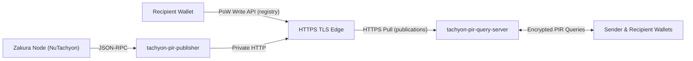

# tachyon-payments [![Docs][docs-badge]][docs] [![X][x-badge]][x]

[docs]: https://tachyon.fastz.cash
[docs-badge]: https://img.shields.io/badge/docs-tachyon.fastz.cash-f4b728
[x]: https://x.com/zcashlabs
[x-badge]: https://img.shields.io/twitter/follow/zcashlabs

Private-retrieval (PIR) services for the Tachyon payment protocol on [Zcash](https://z.cash), built by [Zcash Labs](https://zcashlabs.com). Full documentation and operator guides are published at **[tachyon.fastz.cash](https://tachyon.fastz.cash)**. A wallet uses these services to fetch the data it needs to receive payments without revealing to the server which entry it is querying.

Four products, each served as bucket-row PIR tables:

- **[Memo](docs/pages/products/memo/index.mdx)**: epoched memo database, `tag => memo`.
- **[First-contact](docs/pages/products/first-contact/index.mdx)**: first-contact memo database, `tag => KEM.c || memo`, over spans of epochs.
- **[Tachygram](docs/pages/products/tachygram/index.mdx)**: epoched tachygram database used to verify note commitment inclusion and nullifier absence.
- **[Registry](docs/pages/products/registry/index.mdx)**: off-chain address registry, `H(addr) => addr`, with a PoW-gated, rate-limited write API.

One publisher process (`tachyon-pir-publisher`) follows a [Zakura](https://github.com/zakura-core/zakura) node, builds deterministic PIR tables, and publishes them as content-addressed objects; query hosts (`tachyon-pir-query-server`) pull those publications over HTTPS and answer encrypted row queries.



The wire and operational contract is the [implementation specification](docs/spec/spec-tachyon-payment-pir.md). The design mirrors [`valargroup/wallet-pir`](https://github.com/valargroup/wallet-pir) at revision `40b0ba6a` and reuses its shared libraries (`pir-publication`, `pir-pipeline`, `pir-sync-manager`, `pir-control`, `pir-node-rpc`, and others) as pinned git dependencies.

## Layout

| Directory | Contents |
| --- | --- |
| `src/shared/` | `tachyon-chain` (node reads), `tachyon-pir-protocol` (wallet-facing contract), `tachyon-pir-table` (bucket-row PIR table), `tachyon-pir-distribution` (publication sync) |
| `src/memo/`, `src/tachygram/`, `src/registry/` | Each product's store and publisher crates; first-contact shares the memo crates |
| `src/tachyon-pir-publisher`, `src/tachyon-pir-query-server` | Publisher and query-server binaries |
| `tools/` | Probe client (`tools/client`), end-to-end tests (`tools/e2e-tests`), node double and fixtures (`tools/fixtures`), CI gates (`tools/ci`) |
| `docs/` | Vocs documentation site (quickstart, operator guide, product docs) and the [spec](docs/spec/spec-tachyon-payment-pir.md) |

## Build and test

Prerequisites: `rustup` with the toolchain pinned in `rust-toolchain.toml` (1.97.1, with `rustfmt` and `clippy`), `git`, `make`, and Python 3.11+.

```console
make doctor                       # verify toolchain and prerequisites
make check-package PACKAGE=tachyon-chain
make check-fast BASE=origin/master
make check-correctness            # all workspace tests under release-fast
make check-full                   # fmt, boundary check, clippy, and tests
```

Build the host binaries with all four products enabled:

```console
cargo build --release -p tachyon-pir-publisher --features memo,first-contact,tachygram,registry
cargo build --release -p tachyon-pir-query-server --features memo,first-contact,tachygram,registry
cargo build --release -p tachyon-pir-cli
```

See [AGENTS.md](AGENTS.md) for development rules, dependency boundaries, and test budgets.

## Documentation

Published at **[tachyon.fastz.cash](https://tachyon.fastz.cash)**. The site uses [Vocs](https://vocs.dev) under `docs/`:

```console
cd docs
npm install
npm run dev
```
