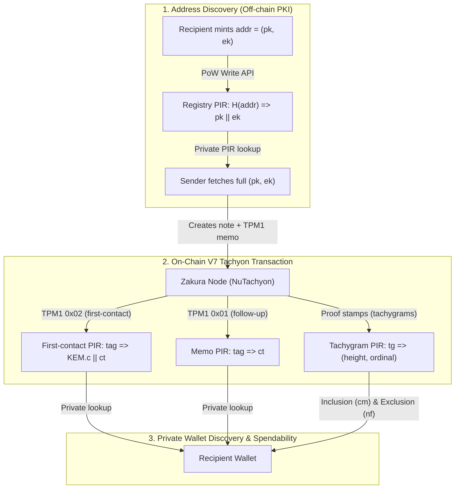
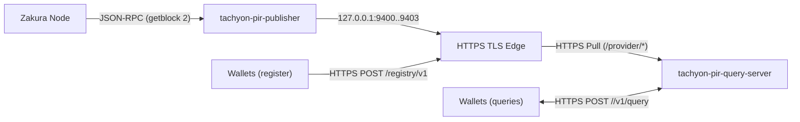

# Architecture

`tachyon-payments` implements the server-side Private Information Retrieval (PIR) layer of the Tachyon payment protocol on Zcash, as outlined in the Tachyon Book's *Payment Protocol* design.

## Why PIR is Needed

Traditional shielded Zcash wallets discover incoming payments by downloading every encrypted note on chain and running **linear trial decryption** against their incoming viewing key (`ivk`). As throughput scales, linear scanning becomes too slow for bandwidth-limited mobile wallets and leaks sync metadata.

Tachyon makes this even sharper by adopting **post-quantum ML-KEM** for note transmission:

- In Orchard, diversified addresses share one elliptic-curve `ivk`, which is convenient for scanning but not quantum-private (a future quantum adversary who recovers `ivk` exposes every past and future note).
- In Tachyon, each sender gets a freshly sampled payment address `addr = (pk, ek)` where `(ek, dk) ← ML-KEM.KeyGen()`. Without a single shared `ivk`, linear trial decryption would multiply by the number of per-sender `dk` keys in the wallet.

**Tags + PIR solve both problems:** every encrypted memo is published on chain with a fresh, unlinkable **tag** predictable only to the sender and recipient. Instead of scanning the chain, the wallet queries a single-server PIR database directly by tag—retrieving its encrypted memo in constant online queries without revealing which tag it queried.

Because single-server PIR scales as `O(√N)` per table, the protocol splits state into **four bounded databases**:

## Two-Host Deployment Topology

1. **`tachyon-pir-publisher`**: Follows a [Zakura](https://github.com/zakura-core/zakura) node over JSON-RPC (`getblockchaininfo`, `getblockcount`, `getblockhash`, `getblock <hash> 2`), ingests Tachyon proof stamps and `vMemoTachyon` envelopes, accepts PoW-gated address registrations, deterministically builds `tachyon-4k8` bucket-row PIR tables, and serves them as content-addressed publications. It never contacts query servers.
2. **HTTPS TLS Edge**: Terminates TLS in front of the publisher's private listeners, routing service discovery (`/.well-known/pir-service-discovery`), publication pull endpoints (`/provider/<product>/v1/*`), and the public registry write API (`/registry/v1/*`).
3. **`tachyon-pir-query-server`**: Pulls publications from the publisher over HTTPS, verifies digests, network identity, and scope bindings, holds resident PIR tables in memory, and answers encrypted row queries from wallets on a single public listener.

## The Four Products

| Product | Mapping | Scope | Mount |
| --- | --- | --- | --- |
| **[Memo](/products/memo)** | `tag => ciphertext(128)` | One Tachyon epoch | `/memo/v1` |
| **[First-contact](/products/first-contact)** | `tag => kem_ct(1088) \|\| ciphertext(128)` | Span of epochs (up to 3,072 entries or 64 epochs) | `/first-contact/v1` |
| **[Tachygram](/products/tachygram)** | `tg(32) => blk_height(u32) \|\| stamp_ordinal(u32)` | One Tachyon epoch | `/tachygram/v1` |
| **[Registry](/products/registry)** | `H(addr) => pk(32) \|\| ek(1184)` | Chunk of 3,072 registrations | `/registry/v1` |

Every product also accepts the legacy alias `/v1/<product>`.

## Dependency Boundaries & Determinism

CI (`tools/ci/boundary.py`) enforces two strict architectural invariants across the Cargo workspace:

- **Serving code never depends on chain or ingestion code.** `tachyon-pir-protocol`, `tachyon-pir-table`, and `tachyon-pir-query-server` cannot reach `tachyon-chain`, any product store/publisher, or `pir-node-rpc`.
- **Product families never depend on each other.** The memo (including first-contact), tachygram, and registry crates are isolated from one another.

Sealed tables are a pure function of the chain (or registration log) and the protocol constants: rebuilding from scratch or across restarts produces byte-identical tables and digests.

## Specification

The normative contract for wire formats, table geometry, placement hashing, and operational rules is [`docs/spec/spec-tachyon-payment-pir.md`](https://github.com/zcashlabs/tachyon-payments/blob/master/docs/spec/spec-tachyon-payment-pir.md).
