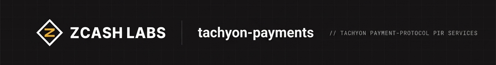

import { HomePage } from 'vocs/components'

<HomePage.Root>
  
  <HomePage.Tagline>
    Private-retrieval (PIR) services for the Tachyon payment protocol on Zcash, built by Zcash Labs.
  </HomePage.Tagline>
  <HomePage.Description>
    Four single-server PIR databases — memo, first-contact, tachygram, and address registry — backed by a deterministic publisher and stateless query hosts.
  </HomePage.Description>
  <HomePage.Buttons>
    <HomePage.Button href="/wallet-tutorial" variant="accent">Wallet Tutorial</HomePage.Button>
    <HomePage.Button href="/quickstart">Local Quickstart</HomePage.Button>
    <HomePage.Button href="/operator/building">Operator Guide</HomePage.Button>
    <HomePage.Button href="/architecture">Architecture</HomePage.Button>
  </HomePage.Buttons>
</HomePage.Root>
