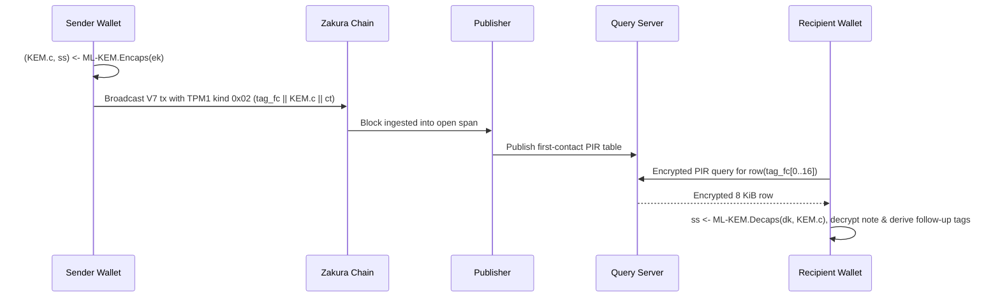

# First-contact

The **first-contact** database lets a wallet privately discover initial payments from new senders (`tag => KEM.c || ciphertext`), carrying the ML-KEM-768 encapsulation ciphertext alongside the encrypted note opening.



| Property | Value |
| --- | --- |
| Scope | Contiguous span of epochs (`scope_id = first_epoch`), closing at 3,072 entries or 64 epochs |
| Source | On-chain `vMemoTachyon` envelopes, kind `0x02` ([spec §5](https://github.com/zcashlabs/tachyon-payments/blob/master/docs/spec/spec-tachyon-payment-pir.md#5-on-chain-envelope-provisional)) |
| Entry layout | `key16 (16) \|\| kem_ct (1088) \|\| ciphertext (128)` = **1,232 bytes** |
| Slots per row | 6 (`floor(8192 / 1232)`), target load 1 (~4,096 entries per `tachyon-4k8` table) |
| Protocol string | `tachyon-first-contact-pir-v1` |
| Query magic | `TFQ1` |
| Mount | `/first-contact/v1` (legacy alias `/v1/first-contact`) |
| Default retention | All spans |

## Span boundaries

First-contact traffic is much lower volume than follow-up memos, so scopes group multiple epochs into spans ([spec §7.2](https://github.com/zcashlabs/tachyon-payments/blob/master/docs/spec/spec-tachyon-payment-pir.md#72-first-contact)):

- Span boundaries are decided deterministically at epoch boundaries and depend only on the chain.
- The open span closes at the first epoch boundary where it holds at least `FC_SPAN_TARGET = 3,072` entries or has spanned `FC_SPAN_MAX_EPOCHS = 64` epochs.
- A span seals once its last epoch reaches `SEAL_DEPTH = 100` blocks past the end of that epoch.

## Placement & duplicate tags

Entries are keyed by `key16 = tag[0..16]`:

```text
h      = SHA-256("tachyon-pir/first-contact/v1/place\0" || genesis_hash(32) || scope_id(u64 LE) || seed(u32 LE) || key16(16))
bucket = u32_le(h[4..8]) mod n_buckets
row    = u32_le(h[0..4]) mod rows
```

Every entry for a tag is retained in ordinal order `(height, tx_index, entry_index)` so front-runners cannot censor a handshake ([spec §5.3](https://github.com/zcashlabs/tachyon-payments/blob/master/docs/spec/spec-tachyon-payment-pir.md#53-duplicate-tags)).

## Wire protocol & operations

- First-contact runs inside the `memo` publisher and shares its listener and `state_dir` (enable both `memo` and `first_contact` in [Publisher Configuration](/operator/publisher)).
- Common table geometry, map format, and query framing: [Shared Table & Wire Protocol](/reference/shared) and [spec §7.2](https://github.com/zcashlabs/tachyon-payments/blob/master/docs/spec/spec-tachyon-payment-pir.md#72-first-contact).
