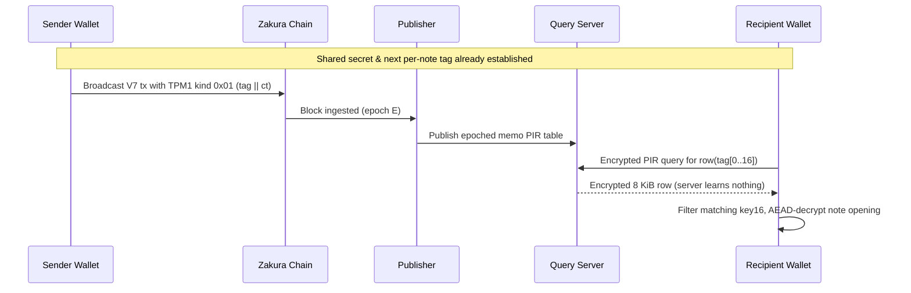

# Memo

The **memo** database lets a wallet privately fetch follow-up payment memos (`tag => ciphertext`) for an established sender–recipient pair, scoped per Tachyon epoch.



| Property | Value |
| --- | --- |
| Scope | One Tachyon epoch (`scope_id = epoch`) |
| Source | On-chain `vMemoTachyon` envelopes, kind `0x01` ([spec §5](https://github.com/zcashlabs/tachyon-payments/blob/master/docs/spec/spec-tachyon-payment-pir.md#5-on-chain-envelope-provisional)) |
| Entry layout | `key16 (16) \|\| ciphertext (128)` = **144 bytes** |
| Slots per row | 56 (`floor(8192 / 144)`), target load 34 (~139,264 entries per `tachyon-4k8` table) |
| Protocol string | `tachyon-memo-pir-v1` |
| Query magic | `TMQ1` |
| Mount | `/memo/v1` (legacy alias `/v1/memo`) |
| Default retention | 64 epochs |

## On-chain envelope (`TPM1`)

Each Tachyon bundle carries an opaque `vMemoTachyon` blob. The provisional payment-protocol envelope ([spec §5.1](https://github.com/zcashlabs/tachyon-payments/blob/master/docs/spec/spec-tachyon-payment-pir.md#51-envelope)) packs 1 to 16 entries:

```text
envelope    = "TPM1" || entry_count (u8, 1..=16) || entry*
entry       = kind (u8) || tag (32) || body
```

- `kind = 0x01` (follow-up memo): `ciphertext` (128 bytes) — indexed in **memo**.
- `kind = 0x02` (first-contact): `kem_ciphertext (1088) || ciphertext (128)` — indexed in **[first-contact](/products/first-contact)**.
- `kind = 0x03` (wallet state): `len (u16 LE) || ciphertext` (`len <= 1024`) — counted and ignored.

Invalid or truncated envelopes are skipped whole and counted (`tachyon_memo_envelopes_invalid_total`); they never halt ingestion.

## Placement & duplicate tags

Entries are keyed by `key16 = tag[0..16]` (all-zero `key16` is rejected):

```text
h      = SHA-256("tachyon-pir/memo/v1/place\0" || genesis_hash(32) || epoch(u64 LE) || seed(u32 LE) || key16(16))
bucket = u32_le(h[4..8]) mod n_buckets
row    = u32_le(h[0..4]) mod rows
```

Because tags are visible in the mempool, anyone can publish a colliding entry for the same tag. The publisher keeps **every** entry for a tag in deterministic ordinal order `(height, tx_index, entry_index)` ([spec §5.3](https://github.com/zcashlabs/tachyon-payments/blob/master/docs/spec/spec-tachyon-payment-pir.md#53-duplicate-tags)), and the wallet authenticates candidates by AEAD decryption.

## Wire protocol & operations

- Common table geometry, map format, and query framing: [Shared Table & Wire Protocol](/reference/shared) and [spec §7.1](https://github.com/zcashlabs/tachyon-payments/blob/master/docs/spec/spec-tachyon-payment-pir.md#71-memo-epoched).
- Configuration and deployment: [Publisher Configuration](/operator/publisher) and [Query Server Configuration](/operator/query-server).
