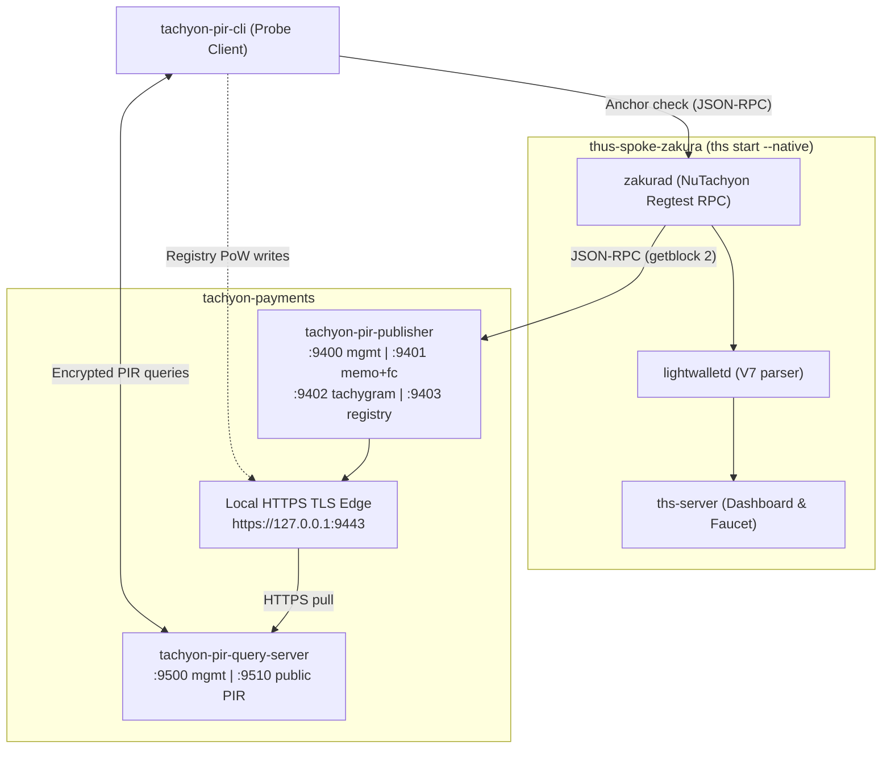

# Local Regtest Quickstart

This guide runs the full PIR stack — a local `NuTachyon` Zakura node, `tachyon-pir-publisher`, an HTTPS edge, `tachyon-pir-query-server`, and `tachyon-pir-cli` — on your machine.

## What This Starts



## 1. Start a local `NuTachyon` regtest node

Use the `tachyon-payments` branch of [`zcashlabs/thus-spoke-zakura`](https://github.com/zcashlabs/thus-spoke-zakura/tree/tachyon-payments) (`ths`), which runs a disposable `NuTachyon`-enabled Zakura node, `lightwalletd`, and a wallet-backed faucet/dashboard natively:

```console
git clone -b tachyon-payments https://github.com/zcashlabs/thus-spoke-zakura.git
cd thus-spoke-zakura
ths start --native
```

Once ready, print the instance's endpoints in another terminal:

```console
ths endpoints --env
```

Note `THS_ZAKURA_RPC_URL` (for example `http://127.0.0.1:40445`) and fetch the regtest genesis hash:

```console
ths rpc getblockhash 0
# e.g. 029f11d80ef9765602235e1bc9727e3eb6ba20839319f761fee920d63401e327
```

Confirm `NuTachyon` (`fffffffc`) is active:

```console
ths rpc getblockchaininfo
```

## 2. Build the PIR binaries

In `tachyon-payments`:

```console
cargo build --profile release-fast -p tachyon-pir-publisher --features memo,first-contact,tachygram,registry
cargo build --profile release-fast -p tachyon-pir-query-server --features memo,first-contact,tachygram,registry
cargo build --profile release-fast -p tachyon-pir-cli
```

## 3. Generate a local CA and leaf TLS certificate

`tachyon-pir-query-server` requires an HTTPS publisher origin and rejects a CA certificate used directly as a leaf certificate (`CaUsedAsEndEntity`), so generate a local CA plus a leaf cert for `127.0.0.1`:

```console
mkdir -p .local-pir/regtest
openssl req -x509 -newkey rsa:2048 -nodes \
  -keyout .local-pir/regtest/ca.key -out .local-pir/regtest/ca.pem \
  -days 365 -subj "/CN=tachyon-local-ca" \
  -addext "basicConstraints=critical,CA:TRUE" \
  -addext "keyUsage=critical,keyCertSign,cRLSign"

openssl req -newkey rsa:2048 -nodes \
  -keyout .local-pir/regtest/server.key -out .local-pir/regtest/server.csr \
  -subj "/CN=127.0.0.1"

printf "basicConstraints=CA:FALSE\nsubjectAltName=IP:127.0.0.1,DNS:localhost\nkeyUsage=digitalSignature,keyEncipherment\nextendedKeyUsage=serverAuth\n" \
  > .local-pir/regtest/server.ext

openssl x509 -req -in .local-pir/regtest/server.csr \
  -CA .local-pir/regtest/ca.pem -CAkey .local-pir/regtest/ca.key -CAcreateserial \
  -out .local-pir/regtest/server.pem -days 365 -extfile .local-pir/regtest/server.ext
```

## 4. Configure and start the publisher

Create `.local-pir/regtest/publisher.json` (replace `rpc_url` and absolute `state_dir` paths for your machine):

```json
{
  "management_listen": "127.0.0.1:9400",
  "chain": {
    "rpc_url": "http://127.0.0.1:40445",
    "no_auth": true,
    "poll_ms": 500,
    "epoch_length": 64
  },
  "memo": {
    "enabled": true,
    "settings": {
      "listen": "127.0.0.1:9401",
      "state_dir": "/abs/path/to/tachyon-payments/.local-pir/regtest/pub-memo"
    }
  },
  "first_contact": { "enabled": true, "settings": {} },
  "tachygram": {
    "enabled": true,
    "settings": {
      "listen": "127.0.0.1:9402",
      "state_dir": "/abs/path/to/tachyon-payments/.local-pir/regtest/pub-tachygram"
    }
  },
  "registry": {
    "enabled": true,
    "settings": {
      "listen": "127.0.0.1:9403",
      "state_dir": "/abs/path/to/tachyon-payments/.local-pir/regtest/pub-registry",
      "difficulty_bits": 8
    }
  }
}
```

Validate offline and start:

```console
./target/release-fast/tachyon-pir-publisher --config .local-pir/regtest/publisher.json --check
./target/release-fast/tachyon-pir-publisher --config .local-pir/regtest/publisher.json
```

Start your HTTPS reverse proxy on `https://127.0.0.1:9443` routing `/.well-known/`, `/provider/memo/`, `/provider/first-contact/`, `/provider/tachygram/`, `/provider/registry/`, and `/registry/` to ports `9400`–`9403` (see [TLS Edge & Routing](/operator/tls-edge)).

## 5. Configure and start the query server

Create `.local-pir/regtest/query.json` (using the genesis hash from step 1 and `activation_height: 1`, `epoch_length: 64` for chain products; `registry` omits both):

```json
{
  "management_listen": "127.0.0.1:9500",
  "public_listen": "127.0.0.1:9510",
  "memo": {
    "enabled": true,
    "settings": {
      "publisher": "https://127.0.0.1:9443",
      "publisher_ca": "/abs/path/to/tachyon-payments/.local-pir/regtest/ca.pem",
      "state_dir": "/abs/path/to/tachyon-payments/.local-pir/regtest/query-memo",
      "role": "combined",
      "publisher_network": "test",
      "publisher_genesis": "029f11d80ef9765602235e1bc9727e3eb6ba20839319f761fee920d63401e327",
      "activation_height": 1,
      "epoch_length": 64,
      "poll_ms": 500
    }
  },
  "first_contact": {
    "enabled": true,
    "settings": {
      "publisher": "https://127.0.0.1:9443",
      "publisher_ca": "/abs/path/to/tachyon-payments/.local-pir/regtest/ca.pem",
      "state_dir": "/abs/path/to/tachyon-payments/.local-pir/regtest/query-first-contact",
      "role": "combined",
      "publisher_network": "test",
      "publisher_genesis": "029f11d80ef9765602235e1bc9727e3eb6ba20839319f761fee920d63401e327",
      "activation_height": 1,
      "epoch_length": 64,
      "poll_ms": 500
    }
  },
  "tachygram": {
    "enabled": true,
    "settings": {
      "publisher": "https://127.0.0.1:9443",
      "publisher_ca": "/abs/path/to/tachyon-payments/.local-pir/regtest/ca.pem",
      "state_dir": "/abs/path/to/tachyon-payments/.local-pir/regtest/query-tachygram",
      "role": "combined",
      "publisher_network": "test",
      "publisher_genesis": "029f11d80ef9765602235e1bc9727e3eb6ba20839319f761fee920d63401e327",
      "activation_height": 1,
      "epoch_length": 64,
      "poll_ms": 500
    }
  },
  "registry": {
    "enabled": true,
    "settings": {
      "publisher": "https://127.0.0.1:9443",
      "publisher_ca": "/abs/path/to/tachyon-payments/.local-pir/regtest/ca.pem",
      "state_dir": "/abs/path/to/tachyon-payments/.local-pir/regtest/query-registry",
      "role": "combined",
      "publisher_network": "test",
      "publisher_genesis": "029f11d80ef9765602235e1bc9727e3eb6ba20839319f761fee920d63401e327",
      "poll_ms": 500
    }
  }
}
```

Validate offline and start:

```console
./target/release-fast/tachyon-pir-query-server --config .local-pir/regtest/query.json --check
./target/release-fast/tachyon-pir-query-server --config .local-pir/regtest/query.json
```

## 6. Probe with `tachyon-pir-cli`

Verify readiness and fetch anchor-checked maps for all four products:

```console
curl -fsS http://127.0.0.1:9400/ready
curl -fsS http://127.0.0.1:9500/ready

./target/release-fast/tachyon-pir-cli --origin http://127.0.0.1:9510 --product memo --node http://127.0.0.1:40445 map
./target/release-fast/tachyon-pir-cli --origin http://127.0.0.1:9510 --product first-contact --node http://127.0.0.1:40445 map
./target/release-fast/tachyon-pir-cli --origin http://127.0.0.1:9510 --product tachygram --node http://127.0.0.1:40445 map
./target/release-fast/tachyon-pir-cli --origin http://127.0.0.1:9510 --product registry map
```

See [Probe Client (CLI)](/operator/cli) for running encrypted `lookup` and `dummy` queries.
