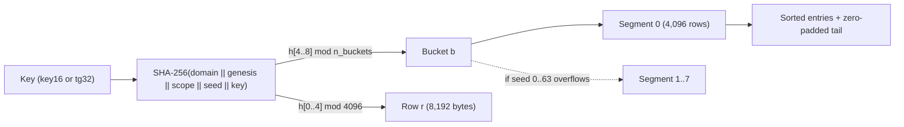

# Shared Table & Wire Protocol

All four PIR products share one bucket-row table format, one PIR cryptographic profile, and one HTTP serving protocol. The normative contract is [`spec-tachyon-payment-pir.md`](https://github.com/zcashlabs/tachyon-payments/blob/master/docs/spec/spec-tachyon-payment-pir.md).

## Bucket-row table

Every table uses the `tachyon-4k8` geometry ([spec §6.1](https://github.com/zcashlabs/tachyon-payments/blob/master/docs/spec/spec-tachyon-payment-pir.md#61-geometry)): **4,096 rows × 8,192 bytes** (32 MiB raw).

- Each row holds `floor(8192 / ENTRY_BYTES)` fixed-size slots.
- Occupied entries come first, sorted ascending by `(key, ordinal)`, followed by zero-filled unused slots and tail padding.
- Every key starts with a non-zero prefix, so an all-zero slot unambiguously marks the end of occupied entries.
- Both server and client validate canonical row ordering and zero padding.

### Overflow & segments

If a bucket cannot place all its entries into 4,096 rows within `MAX_SEEDS = 64` deterministic seed retries, the bucket splits into up to `MAX_SEGMENTS = 8` segments ([spec §6.4](https://github.com/zcashlabs/tachyon-payments/blob/master/docs/spec/spec-tachyon-payment-pir.md#64-seeds-overflow-and-segments)). A client looking up a key in a multi-segment bucket queries every segment of that bucket.

### Open vs. sealed scopes

- **Open scopes** (current epoch, open first-contact span, open registry chunk) are rebuilt on each publication as new data arrives.
- **Sealed scopes** (epochs past `SEAL_DEPTH = 100` blocks, full registry chunks) are immutable and deterministic: rebuilding from the same chain or log produces identical bytes and SHA-256 digests ([spec §6.5](https://github.com/zcashlabs/tachyon-payments/blob/master/docs/spec/spec-tachyon-payment-pir.md#65-open-and-sealed-tables)).

## PIR profile

All tables use `wallet-pir`'s native 8-bit PIR profile (`P8`, `D = 2048`, `Q = 2^64 - 2^32 + 1`) ([spec §6.6](https://github.com/zcashlabs/tachyon-payments/blob/master/docs/spec/spec-tachyon-payment-pir.md#66-pir-profile)). One query retrieves a full 8,192-byte row with an identical transcript whether the key is present or absent.

## HTTP routes

Every enabled product is mounted on `tachyon-pir-query-server`'s `public_listen` at `/<product>/v1` (with legacy alias `/v1/<product>`) ([spec §10](https://github.com/zcashlabs/tachyon-payments/blob/master/docs/spec/spec-tachyon-payment-pir.md#10-wallet-facing-protocol)):

| Route | Purpose |
| --- | --- |
| `GET map` | Returns the map head JSON (`network`, `genesis_hash`, anchor or `log_sequence`, `generation`, open scopes, and sealed chunk references) |
| `GET map/chunks/<sha256>` | Immutable sealed map chunk (up to 32 scopes per chunk) |
| `GET public/<sha256>` | Immutable PIR public setup bytes for a table |
| `POST query` | Encrypted PIR row query (`magic(4) \|\| session_id(32) \|\| nonce(16) \|\| payload`; max 512 KiB). The 52-byte header is echoed in the response |

## Byte-order & trust rules

- All protocol integers are **little-endian**.
- Block hashes and txids are held in **protocol order** (reversed RPC hex) for all hash inputs, and printed in **display order** in JSON ([spec §3](https://github.com/zcashlabs/tachyon-payments/blob/master/docs/spec/spec-tachyon-payment-pir.md#3-chain-facts-this-spec-relies-on)). Tachygrams, anchors, tags, and digests are never reversed.
- Wallets must verify the map's `genesis_hash` and `anchor_hash` against a trusted chain view before trusting query results ([spec §12.1](https://github.com/zcashlabs/tachyon-payments/blob/master/docs/spec/spec-tachyon-payment-pir.md#121-what-the-wallet-must-do)).
