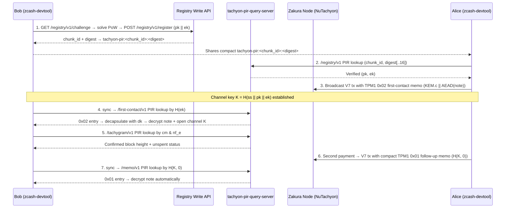

# Wallet Tutorial (`zcash-devtool`)

This tutorial walks through a complete private Tachyon payment flow between **Alice** and **Bob** using [`zcashlabs/zcash-devtool`](https://github.com/zcashlabs/zcash-devtool) — our fork of `cnode-agent/zcash-devtool` with native support for all four `tachyon-payments` PIR products (`registry`, `first-contact`, `memo`, and `tachygram`) and on-chain `TPM1` envelopes in `vMemoTachyon`.

No out-of-band `payment.json` receipts are passed between wallets.

## End-to-End Flow



## 1. Build `zcash-devtool` with Tachyon support

```console
git clone https://github.com/zcashlabs/zcash-devtool.git
cd zcash-devtool
RUSTFLAGS='--cfg zcash_unstable="nutachyon"' cargo build --release --locked --features tachyon
```

The binary is built at `./target/release/zcash-devtool`.

## 2. Initialize Alice and Bob

Point both wallets at your Zakura RPC node (for example, the Tachyon alpha testnet at `http://tachyscan.cnode.phd:18232`, activation height `8`) and your `tachyon-payments` PIR query server (`--pir-url`). If the Registry write API is hosted on a separate origin, pass `--registry-write-url`.

```console
DEVTOOL="./target/release/zcash-devtool"
RPC_URL="http://tachyscan.cnode.phd:18232"
PIR_URL="https://pir.example"
REG_WRITE_URL="https://pir.example"

"$DEVTOOL" tachyon --wallet-dir "$HOME/alice-wallet" init \
  --rpc-url "$RPC_URL" \
  --pir-url "$PIR_URL" \
  --registry-write-url "$REG_WRITE_URL" \
  --activation-height 8 \
  --accept-mock-proofs

"$DEVTOOL" tachyon --wallet-dir "$HOME/bob-wallet" init \
  --rpc-url "$RPC_URL" \
  --pir-url "$PIR_URL" \
  --registry-write-url "$REG_WRITE_URL" \
  --activation-height 8 \
  --accept-mock-proofs
```

:::tip
For local testing with a self-signed TLS edge (such as the [Local Regtest Quickstart](/quickstart)), pass `--pir-ca-file /path/to/ca.pem` during `init`.
:::

## 3. Bob registers his address in the Registry

Bob solves the Registry proof-of-work challenge locally and publishes his deterministic `(pk, ek)` address (`32 + 1184 = 1,216` bytes):

```console
"$DEVTOOL" tachyon --wallet-dir "$HOME/bob-wallet" register
```

Example output:

```json
{
  "payment_address": "tachyon-pir:0:9f82c1...e4b1",
  "chunk_id": 0,
  "digest": "9f82c1...e4b1",
  "created": true,
  "visible_after_sequence": 1,
  "ek_index": 0
}
```

Bob can print all of his addresses at any time with `address`:

```console
"$DEVTOOL" tachyon --wallet-dir "$HOME/bob-wallet" address
```

* `payment_address` (`tachyon-pir:<chunk_id>:<digest>`) — compact address resolved via `/registry/v1` PIR.
* `tachyon_full_address` (`tachyon-full:<hex>`) — inline `(pk || ek)` address if you want to skip Registry PIR.
* `tachyon_address` (`tachyon-test:<pk>`) — legacy bare payment key (requires out-of-band `export-receipt` / `receive`).
* `funding_address` — transparent testnet address for shielding funds into Tachyon.

## 4. Fund and shield Alice's wallet

Send testnet funds to Alice's `funding_address`, sync, and shield a note into the Tachyon pool:

```console
"$DEVTOOL" tachyon --wallet-dir "$HOME/alice-wallet" sync --max-blocks 10000
"$DEVTOOL" tachyon --wallet-dir "$HOME/alice-wallet" shield 1000000
```

Wait for confirmation and sync again:

```console
"$DEVTOOL" tachyon --wallet-dir "$HOME/alice-wallet" sync --max-blocks 10000
"$DEVTOOL" tachyon --wallet-dir "$HOME/alice-wallet" balance
```

## 5. First payment: Alice → Bob (`0x02` First-Contact)

Alice sends directly to Bob's compact `tachyon-pir:` address with an optional encrypted `--memo` (up to 37 UTF-8 bytes):

```console
"$DEVTOOL" tachyon --wallet-dir "$HOME/alice-wallet" send \
  --to "tachyon-pir:0:9f82c1...e4b1" \
  --amount-zat 300000 \
  --memo "hello via first-contact"
```

Under the hood, `zcash-devtool`:

1. Queries `/registry/v1` via PIR for `(chunk_id, digest[..16])` and verifies `H(pk || ek) == digest`.
2. Encapsulates a fresh ML-KEM-768 shared secret `ss` to Bob's `ek`, deriving channel key `K`.
3. Encrypts the note (`value_zat`, `psi`, `rcm`, and text memo) into a 128-byte ChaCha20-Poly1305 ciphertext and encodes a `TPM1` `0x02` first-contact envelope into `vMemoTachyon`.
4. Atomically persists the outbound channel `(peer_digest, K, next_tag_index = 0)` and broadcasts the signed V7 transaction.

The JSON output reports `"payment_mode": "first-contact"`.

## 6. Bob discovers the payment privately via PIR

Once the transaction is mined and ingested by `tachyon-pir-publisher` (2 blocks below tip), Bob runs `sync` — with **no** `receive --receipt` step:

```console
"$DEVTOOL" tachyon --wallet-dir "$HOME/bob-wallet" sync --max-blocks 10000
"$DEVTOOL" tachyon --wallet-dir "$HOME/bob-wallet" balance
```

During `sync`, Bob's wallet:

1. Verifies each PIR map's `genesis_hash` and `anchor_hash` against the Zakura RPC node.
2. Queries `/first-contact/v1` by `H(ek)[..16]`, decapsulates with `dk`, decrypts the note, and opens an inbound channel `K`.
3. Queries `/tachygram/v1` by `cm` and `nf_e` to confirm inclusion height and unspent status without leaking any txid or commitment to the node.

## 7. Follow-up payment: Alice → Bob (`0x01` Memo)

When Alice sends to Bob again, `zcash-devtool` automatically detects the established outbound channel and switches from a 1,216-byte `0x02` first-contact entry to a compact 128-byte `0x01` follow-up entry tagged with `H(K, 0)`:

```console
"$DEVTOOL" tachyon --wallet-dir "$HOME/alice-wallet" send \
  --to "tachyon-pir:0:9f82c1...e4b1" \
  --amount-zat 100000 \
  --memo "second payment"
```

The JSON output reports `"payment_mode": "follow-up"`. After mining and ingestion, Bob runs `sync` again to pick up the payment via `/memo/v1` PIR and inspect his channels:

```console
"$DEVTOOL" tachyon --wallet-dir "$HOME/bob-wallet" sync --max-blocks 10000
"$DEVTOOL" tachyon --wallet-dir "$HOME/bob-wallet" channels
"$DEVTOOL" tachyon --wallet-dir "$HOME/bob-wallet" balance
```

## What Still Uses Zakura RPC

* **Spendability proving across closed epochs**: `/tachygram/v1` PIR gives private note confirmation and spend-status checks, while constructing Ragu `NoteSpendable` proofs across closed epochs still uses `gettachyonblock` history until an Oblivious Syncing Service (OSS) is integrated.
* **Transparent funding & broadcast**: `shield`, `unshield`, `transparent-send`, and `sendrawtransaction` talk to the configured Zakura RPC endpoint.
* **Legacy receipts**: Sending to a bare `tachyon-test:<pk>` address continues to work with `export-receipt` and `receive --receipt` for backwards compatibility with faucets and older tools.
